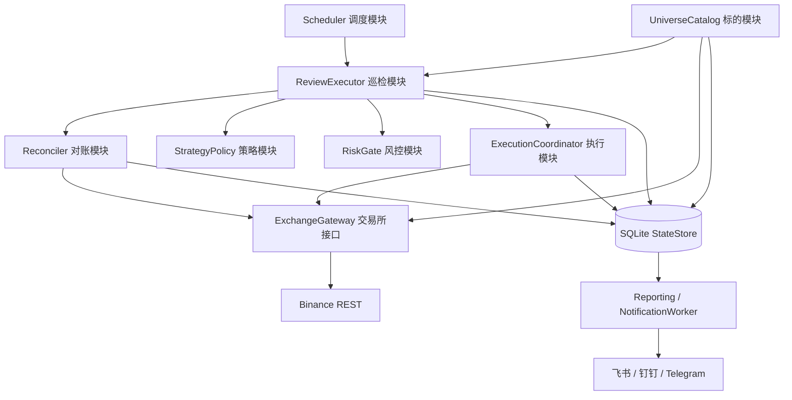
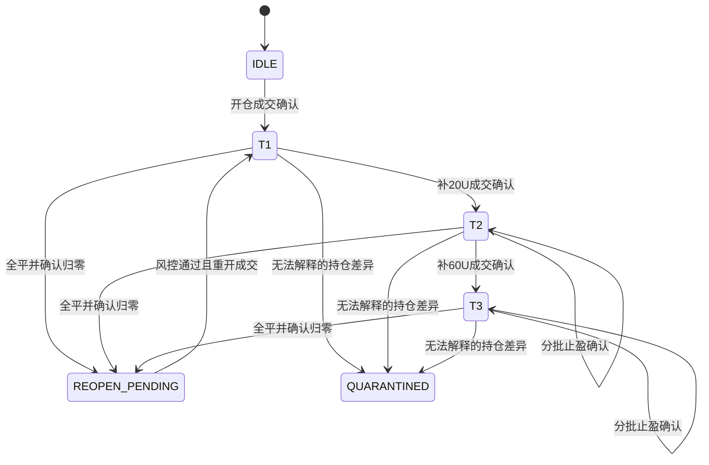
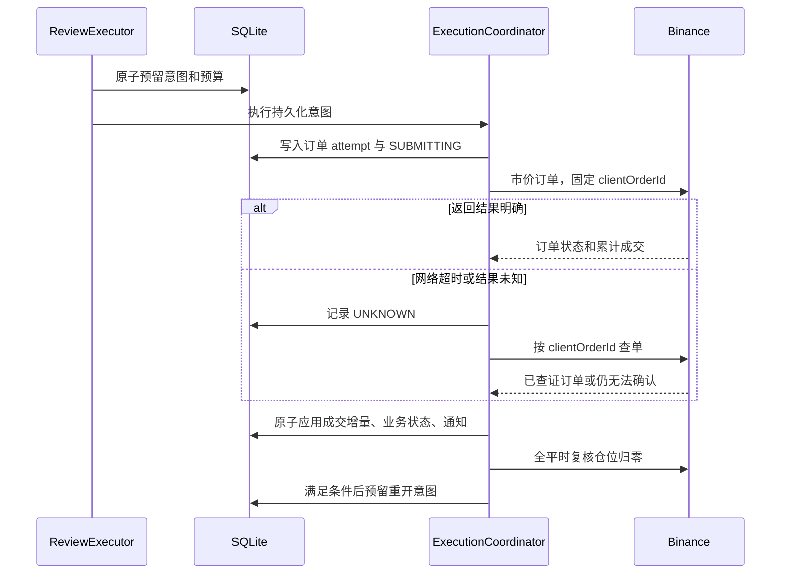

# 15 分钟定时收益统计自动化交易系统：架构设计

| 项目 | 内容 |
| --- | --- |
| 文档版本 | 1.0 |
| 日期 | 2026-10-22 |
| 状态 | 架构提案，可用于拆解开发任务；尚未实现或实盘验证 |
| 唯一业务依据 | [PRD v1.0.0](PRD_15M_PERIODIC_REVIEW_TRADING.md) |
| 设计方式 | 从零设计，不以项目现有代码、旧 SPEC 或旧 ADR 为约束 |
| 首期范围 | 单账户、USDT-M 永续、多头、15 分钟市价巡检、T3 封顶 |

## 1. 架构结论

采用 **单进程模块化架构 + 纯策略决策 + SQLite 持久化执行流程 + REST 交易所适配器**。

每 15 分钟读取持仓与账户快照，策略模块输出交易意图；执行模块先把意图写入数据库，再提交订单，确认成交后推进仓位状态。全平与重开是两个有依赖关系的动作，不能视为一次原子操作。

首期采用 PRD 推荐的模式 A：止盈、补仓、重开全部使用市价单。无 WebSocket，无长期策略挂单，无 Redis、消息中间件和分布式调度。待确认订单仍需短时 REST 查询，因此“低频策略判断”不等于“所有网络请求只能每 15 分钟发生一次”。

这里的“无状态轮询”解释为**不依赖持续连接与进程内存恢复交易**。Tier、补仓锚点、止盈批次及订单执行结果必须持久化；系统整体不能设计为无状态。

### 1.1 目标和取舍

| 目标 | 设计选择 | 代价 |
| --- | --- | --- |
| 单台低配 VPS 可运行 | 一个 Python 进程、一个 SQLite 数据库 | 首期不提供跨主机自动高可用 |
| 不重复补仓、不错误重开 | 意图日志、订单查证、状态版本检查 | 网络异常时宁可暂缓，也不猜测成交结果 |
| 策略可验证 | 纯函数决定动作，真实成交驱动状态变更 | 回测需要模拟交易所执行差异 |
| 支持全量合格标的 | 全账户快照、统一限流、分轮开仓 | 首次建仓不承诺同一秒完成 |
| 规则变化集中处理 | 交易所规则与签名隐藏在适配器内 | 需要持续维护交易所契约测试 |
| 收益可核对 | 成交、费用、资金费和现金流分别记账 | 成交确认与财务数据齐全存在时间差 |

## 2. 需求解释与必要修正

以下是本设计对 PRD 的明确解释。涉及产品行为的补充均标为“设计默认”，不冒充 PRD 已有结论，也不直接修改 PRD。

| PRD 表述或缺口 | 本设计处理 | 类型 |
| --- | --- | --- |
| 无状态、数据库丢失可由 10/30/90U 推导 Tier | 必须保存交易历史；无法重建时隔离标的，禁止猜测 Tier | 正确性修正 |
| T2/T3 总持仓名义价值为 30/90U | 30/90U 是未考虑此前卖出时的累计买入预算，不是当前市值 | 口径修正 |
| 分批平仓为 15U 或 30U | 按进入当前 Tier 时的实际数量分批，当前成交名义随价格变化 | 口径修正 |
| 网络超时统一重试三次 | 查询可以重试；下单结果未知时先查单，不能直接再买 | 正确性修正 |
| 全平后立刻重开 | 确认订单终态和仓位归零后，重新过风控再开仓 | 正确性修正 |
| 15m 收盘价与 markPrice 混用 | 用巡检时的标记价格判断；记录实际采样时间，市价单按真实成交价记账 | 设计默认 |
| 相对 T2 买入价再次跌 50% | 使用 T2 加仓订单的实际成交均价，不使用整体持仓均价 | 设计默认 |
| 一个采样周期内连续跨阶 | 每个标的每轮最多晋级一个 Tier，不在同一轮连续补 T2、T3 | 设计默认 |
| 模式 B 可选 | 不进入首期；需要独立挂单管理和补充设计，不能仅切配置启用 | 范围选择 |
| 所有新币自动纳管 | 确认属于原生加密资产且满足交易规则后自动纳管；分类未知则待审 | 设计默认 |
| 保证金率超过 70% 停开新标的 | 将 70% 明确定义为初始保证金使用率；同时暂停补仓和重开，保留已授权减仓 | 风控补充 |
| “立即”熔断告警 | 默认在下一次采样发现后立即告警，最坏检测延迟接近 15 分钟 | 能力说明 |
| 极端行情下“绝无爆仓风险” | 不作为系统保证；必须按权益、维持保证金、浮亏和执行延迟评估 | 正确性修正 |
| SQLite WAL 高并发无锁写入 | 使用单写者与短事务；WAL 不意味着多个写者可同时写入 | 工程修正 |

**为什么不能用市值恢复 Tier：**假设 T1 在 100 买入 10U，得到 0.1 个币；跌到 50 后补 20U，得到 0.4 个币。T2 总数量为 0.5，成本为 30U，但当前市值只有 25U，均价为 60。再发生部分止盈后，单凭当前数量、均价和市值，更无法恢复此前完成的止盈批次。

**资金口径：**杠杆缩小初始保证金要求，不缩小价格变化造成的损益。预算测算必须包含浮亏、手续费、资金费、实际杠杆和维持保证金要求。PRD 的本金区间与历史回测收益不是本架构的安全性或盈利验收标准。

## 3. 系统结构与依赖方向



图中的箭头代表调用或读取关系。模块在同一进程中运行，不是微服务。只有数据库和交易所是真实状态的外部存储。

依赖规则：

- 领域层只包含数据结构、策略规则和不变量，不访问网络、数据库或系统时钟。
- 应用层编排对账、决策、风控和执行，不了解签名、HTTP 字段及 SQL。
- 适配器实现交易所与存储接口；生产适配器和确定性模拟适配器共用同一组接口。
- 启动入口负责创建依赖与加载配置。所有交易写操作只能通过执行模块。
- 通知读取已提交事件，不直接调用策略或交易所下单。

### 3.1 模块职责与小接口

| Module | Interface（概念签名） | 隐藏的 Implementation |
| --- | --- | --- |
| Scheduler | `run_due_jobs(now)` | 整点调度、遗漏合并、任务互斥、北京时间日报 |
| ReviewExecutor | `run(review_slot) -> ReviewResult` | 本轮快照、动作排序、预算、结果汇总 |
| UniverseCatalog | `refresh() / candidates()` | 合约筛选、资产分类、状态变化、筛选原因 |
| StrategyPolicy | `decide(state, observation) -> Decision` | Tier 阈值、累计止盈目标、动作优先级 |
| Reconciler | `reconcile(scope) -> ReconciliationResult` | 未知订单查证、交易补录、持仓差异分类 |
| RiskGate | `authorize(plan, account) -> PermitOrRejection` | 账户闸门、杠杆、预算占用、快照有效性 |
| ExecutionCoordinator | `execute(intent) / recover_pending()` | 订单状态机、真实成交推进、全平重开依赖 |
| ExchangeGateway | `snapshot / rules / submit / lookup / fills / income / configure` | REST 协议、签名、精度、限流、错误归类 |
| StateStore | `transaction / load_state / reserve_intent / apply_execution` | SQL、唯一约束、版本检查、事务性通知记录 |
| Reporting | `daily_report(period)` | 收益分类、对账差额、日报幂等 |
| NotificationWorker | `deliver_pending()` | 渠道格式、退避、去重、积压告警 |

Interface 包含行为约束，而不仅是方法名：`submit` 返回“已确认/明确拒绝/结果未知”；`apply_execution` 必须幂等；`decide` 不改变输入；`execute` 不能绕过风控或持久化意图。以上方法组按真实使用场景实现，避免为每个 HTTP 端点建立一个公开业务方法。

## 4. 运行模型与调度

### 4.1 部署单元

一个由 systemd 守护的常驻进程，内部使用 `asyncio` 和 `httpx.AsyncClient` 复用连接，采用 APScheduler 触发定时任务。SQLite 写入集中在一个写者中；网络请求期间不持有数据库事务。

首期交易命令全局串行执行，便于保证账户资金使用顺序；订单确认采用有界等待，不让单个未知订单永久阻塞其他标的。批量快照与历史补录允许少量并发读取，默认上限 4。若压测证明串行吞吐不足，再引入按标的串行、跨标的并发的执行队列；账户预算仍须集中原子预留。

进程启动持有操作系统文件锁，锁文件位于持久化数据目录。数据库对 review slot 和未完成意图再设唯一约束，防止重复调度。`max_instances=1` 本身不防第二个进程，必须配合进程锁。首期禁止两台机器同时使用同一账户运行此系统。

### 4.2 任务节奏

| 任务 | 触发时间 | 行为 |
| --- | --- | --- |
| 策略巡检 | 每小时 00/15/30/45 分的第 5 秒 | 新的止盈、补仓、空仓开仓决策 |
| 未完成订单恢复 | 启动及存在待确认订单时 | 短时轮询，随后退避；不产生新行情信号 |
| 标的池刷新 | 启动及北京时间每日 08:00 | 形成版本化候选集，新增合格标的在下轮开仓 |
| 交易规则刷新 | 启动、每轮巡检及规则错误后 | 检查状态、精度、交易限制和退市相关信息 |
| 日报 | 北京时间每日 08:00 | 汇总前一日 08:00 至当日 08:00，允许数据补齐后修订 |
| 通知投递 | 有待发送记录时 | 独立于交易路径重试 |
| 数据库备份 | 默认每小时及升级前 | 在线一致性备份，异机保存加密副本 |

所有持久化时间为 UTC 毫秒；日报显示 `Asia/Shanghai`。任务以 `account + strategy_version + slot_start_utc` 标识。重启后先恢复订单，再对当前状态做一次恢复巡检；跳过已错过的历史行情，不能补执行过去时点的买卖。

每日标的刷新失败时使用有有效期的上次候选集，不将失败或空响应解释为“所有标的退市”。已有持仓始终进入巡检集合。日报与池刷新不占用订单执行锁。

### 4.3 快照时效与工作预算

初始建议参数：本轮启动新动作的预算 120 秒，价格最大年龄 10 秒，账户快照最大年龄 30 秒。这些是工程初值，需通过目标标的数量压测调整，不是性能承诺。

超龄前刷新对应快照并重新决策，不拿本轮开始时的旧价格连续交易数分钟。达到预算后停止新动作，已提交订单继续确认；尚未提交的动作在下轮重新判断。每轮记录最早/最晚采样时间，不能把全市场执行描述为同一瞬间成交。

## 5. 领域模型与业务不变量

### 5.1 两类状态分离

**业务状态 `SymbolState`：**

- `symbol, cycle_id, tier, version`：标的、持仓周期、Tier 和乐观版本。
- `lifecycle`：`IDLE / OPEN / REOPEN_PENDING / SETTLEMENT_PENDING / QUARANTINED / RETIRED`。
- `qty, avg_entry_price`：已确认实际数量和持仓均价。
- `tier_entry_qty`：进入当前 Tier 时的实际总数量，作为分批基数。
- `tier_anchor_price`：本 Tier 买入订单的实际成交均价，作为下一次补仓的锚点。
- `tier_sold_qty`：当前 Tier 已确认的累计卖出数量。
- `completed_batches`：已完成目标批次数；由实际数量达标后推进。
- `strategy_version, last_review_slot`：本周期策略参数版本和最近处理时点。

**执行状态 `OrderIntent`：**

- `intent_id, cycle_id, expected_state_version, action`。
- `target_cumulative_close_qty` 或 `buy_budget`：业务目标。
- `status, active_attempt_id, reserved_margin`。
- `origin_review_slot, snapshot_id, reason, created_at`。

订单执行状态独立于 Tier。处于 T2 的仓位可以有一个待确认止盈意图，但不能因为“已发出平仓请求”就标记第一批已完成。

### 5.2 强制不变量

1. 单个标的至多存在一个未终结意图；重开必须等待前一平仓意图终结。
2. Tier 只能在确认买入成交后推进；数量、均价只来自已查证的执行结果。
3. 每个持仓周期最多执行 T1/T2/T3 三次买入动作，预算分别为 10/20/60U；不引入循环补仓。
4. 分批止盈基数为 `tier_entry_qty`，不能使用“当前剩余数量 × 1/3”反复递减。
5. 平仓使用只减仓语义，不能因为重试或舍入产生空头。
6. 重开只有在最新持仓确认为零、无活动或未知订单、风控允许时才能执行。
7. 同一成交、订单累计成交增量和资金费记录各自只能入账一次。
8. 存在无法解释的持仓差异时，该标的停止自动交易并进入隔离状态。
9. T3 封顶限制的是本轮新增买入预算，不限制价格上涨后的持仓市值，也不保证最大账户损失。

## 6. 策略规则与仓位状态机

### 6.1 判断口径

设 `p` 为有效标记价格，`a` 为已对账持仓均价，`Q` 为当前 Tier 初始数量，`S` 为当前 Tier 已确认累计卖出数量：

```text
ret = (p - a) / a                     # 价格收益率，不乘杠杆
dca_trigger = tier_anchor_price × 0.5
close_qty = max(0, cumulative_target - S)
```

均价为零、价格无效、状态未对齐时不决策。真实手续费和资金费进入财务账本，不混入 PRD 的止盈触发收益率。

### 6.2 决策表

| 状态 | 条件（从上到下优先） | 输出意图 | 确认后状态 |
| --- | --- | --- | --- |
| T1 | `ret >= 10%` | 全平 | `REOPEN_PENDING` |
| T1 | `p <= anchor × 0.5` | 买入预算 20U | T2，重设 Q、S、批次和锚点 |
| T2 | `ret >= 50%` | 全平 | `REOPEN_PENDING` |
| T2 | `ret >= 20%` 且第一批未完成 | 累计卖出达到 Q/2 | T2，第一批完成 |
| T2 | `p <= anchor × 0.5` | 买入预算 60U | T3，重设 Q、S、批次和锚点 |
| T3 | `ret >= 100%` | 全平 | `REOPEN_PENDING` |
| T3 | `ret >= 50%` 且前两批未完成 | 累计卖出达到 2Q/3 | T3，前两批完成 |
| T3 | `ret >= 20%` 且第一批未完成 | 累计卖出达到 Q/3 | T3，第一批完成 |
| T3 | 其他情况 | 持有 | 不继续加仓 |
| IDLE | 已纳管、可交易、风控通过 | 买入预算 10U | 新 cycle 的 T1 |
| REOPEN_PENDING | 已确认归零且风控通过 | 买入预算 10U | 新 cycle 的 T1 |

排序规则：对账与未知订单恢复优先；行情动作中止盈优先于补仓；新周期每轮最多重开一次，不在同一快照上反复止盈重开。全账户动作优先执行减仓，其次补仓，最后新开与重开。每次增仓重新检查账户预算；候选队列持久化轮转，避免总是跳过排序靠后的币种。

### 6.3 跳档、部分止盈和精度

- T3 一次跳到 +60% 且未卖过：直接计划累计卖出 2Q/3，不分成两个独立市价单。
- T3 第一批已卖出 Q/3，再到 +60%：只补足累计目标与已卖数量的差。
- T2 第一批卖出后再触发补仓：允许进入 T3；新 Q 为“剩余 T2 数量 + 本次真实买入数量”，旧批次不沿用。
- T1 从锚点一次跌超过 75%：本轮只买 T2，T2 实际成交均价成为新锚点。T3 最早下轮判断，不继续套用初始价的 25%。这是对模式 A 离散采样的明确选择。
- 非最终批次目标按可交易步长向下对齐；最后一批卖出全部可减数量。舍入差进入最后一批，不向上取整超额卖出。
- 目标下单量或剩余量无法合法拆分时，按 PRD 的合批规则计划全平；全平仍不合法时隔离残余仓位，不能补买来“凑单”。

### 6.4 生命周期



退市、隔离与执行中状态为独立控制维度，图中仅展示主要业务路径。被隔离状态不能自动回到 IDLE；需先查证或由操作员提交可审计的恢复指令。

## 7. 一轮巡检如何执行

1. 占用本轮 review slot，恢复未终结意图。已有本轮记录则续跑，不重新创建动作。
2. 获取完整账户持仓、账户权益、必要行情及规则快照。请求失败不等于空仓；快照不完整时不允许自动开仓。
3. 对账集合取“本地非终结状态 ∪ 交易所全部非零持仓 ∪ 待确认订单标的”。不能先过滤掉空头或池外持仓再做检查。
4. 策略对每个已对齐标的输出至多一个主动作；保存理由、阈值、价格时间及策略版本。
5. 按减仓、补仓、新开顺序执行。每个动作提交前检查最新状态版本、价格有效性、规则与账户预算。
6. 全平确认后，由同一个执行流程创建重开后续动作。空闲扫描以更新后的数据库和活动意图为准，不能复用轮初 `positions` 再开一次。
7. 保存账户快照与运行结果；把业务通知写入事务性待发送表。个别标的隔离不影响其他已确认安全标的，账户级异常则停止所有增仓。



## 8. 订单可靠性：先落库、再提交、再查证

### 8.1 幂等范围

每个业务目标有稳定 `intent_id`；每次实际提交有独立 `attempt_id` 和 `client_order_id`。客户端订单号由意图和尝试序号生成，符合交易所长度与字符要求，不包含密钥。

`clientOrderId` 用于关联和查证，不视为交易所永久幂等键。交易所文档约束其在活动订单中唯一；已成交订单不能靠复用同一编号来保证不重买。[交易接口文档](https://developers.binance.com/docs/derivatives/usds-margined-futures/trade/rest-api/New-Order)

系统保证“本地事实幂等应用”和“未查清前不重复提交”，不宣称 SQLite 与远程交易所之间存在端到端 exactly-once 事务。

### 8.2 执行状态

```text
PREPARED -> SUBMITTING -> ACKNOWLEDGED -> PARTIALLY_FILLED -> FILLED
                    \-> UNKNOWN -> 持续查证 / QUARANTINED
                    \-> REJECTED
ACKNOWLEDGED / PARTIALLY_FILLED -> CANCELED / EXPIRED
```

意图完成条件由业务目标决定，不简单等同于某个 attempt 已终结。

| 场景 | 处理 |
| --- | --- |
| 意图已写库，尚未进入 SUBMITTING 即崩溃 | 恢复时重新校验时效与风控，再决定提交或取消 |
| 已写 SUBMITTING，但不确定请求是否发出 | 视为 UNKNOWN；先查单，不能当作未提交 |
| 下单已成功，响应丢失 | 通过客户端订单号和成交记录查证，补齐本地状态 |
| 成交已落库，通知发送前崩溃 | 从待发送表重试，不重复交易 |
| 多次查单仍返回不存在 | 不能仅凭单次或短时“不存在”证明从未受理；保留隔离与告警 |
| 明确拒绝且零成交 | 释放预算，记录错误；仅可恢复错误允许有界重试 |
| 市价单部分成交后终结 | 先应用真实数量，针对剩余业务目标单独处理，不能重发原数量 |
| 本地落库失败而交易所可能已成交 | 立即停新单，保留日志；恢复后先查证再继续 |

HTTP 超时及某类 503 表示执行状态未知，必须查证；429/418 和明确失败按错误类别处理，不采用统一重试装饰器包裹所有写请求。[Binance General Info](https://developers.binance.com/docs/derivatives/usds-margined-futures/general-info)

### 8.3 部分成交的业务规则

**增仓：**等待订单终态。零成交则不推进 Tier；非零成交则按真实数量进入目标 Tier，不自动补齐未花完的 10/20/60U 预算。这是首期的保守默认，可避免连续追价。新锚点为该买入动作的真实加权成交价，批次基数为确认后的总持仓。低于合法后续交易能力的异常小成交进入隔离。

**减仓：**记录累计卖出量，批次锁仅在达到量化后的累计目标时推进。部分终结后的残量意图只有在前单终态、成交已对齐且最新信号仍有效时才创建；信号不再满足则保留已卖数量，下轮再判断。全平过程中未归零不能重开。

订单结果可提供累计成交数量和成交额，而逐笔费用可能稍后返回。对数量采用“已应用累计量”游标防止重放；后续逐笔成交补齐财务，不再重复扣减仓位。两套数据与同一订单关联并核对一致性。

## 9. 交易所适配与精度

### 9.1 首期账户约束

设计默认使用独立策略账户、单向持仓模式、全仓保证金、单资产 USDT 模式，目标杠杆 10x。启动读取并校验账户模式；检测到双向模式、多资产模式或无法解释的人工持仓时停止增仓，不自动切换账户级设置。

首次对空仓标的交易前设置并核验杠杆与保证金模式；已有仓位的模式变更不自动执行。若某标的不支持目标杠杆，则按实际允许杠杆重新测算预算；无法满足风控则跳过，不强行沿用 1U 保证金估算。这些设置操作也需要结果确认。

### 9.2 外部能力清单

| 用途 | 拟使用 REST 能力 |
| --- | --- |
| 时间与规则 | `GET /fapi/v1/time`、`GET /fapi/v1/exchangeInfo` |
| 持仓 | `GET /fapi/v3/positionRisk`，封装为统一快照；需要时明确支持 v2 适配 |
| 账户权益 | `GET /fapi/v3/account` |
| 价格与交易前检查 | 标记价格、最优买卖报价；必要时按单个标的补查 |
| 市价下单与查单 | `POST /fapi/v1/order`、`GET /fapi/v1/order` |
| 对账与账本 | 账户成交记录、收入历史、活动订单查询 |
| 账户与标的配置 | 持仓模式、资产模式、杠杆、保证金模式与风险档位查询/设置 |

持仓 v3 可能只返回有持仓或挂单的标的；只有完整且成功的响应中缺失某标的，才能作为其空仓判断的一部分。`updateTime` 是持仓更新时间，不能当作行情价格新鲜度，应使用请求时间和价格数据时间。[Position Information V3](https://developers.binance.com/docs/derivatives/usds-margined-futures/trade/rest-api/Position-Information-V3)

适配器隐藏端点版本，领域层只读取标准化数据。实施阶段需固定依赖版本、核验账户可用端点，并完成 Demo 环境契约测试；本设计不把文档示例权重或限额硬编码为永恒常量。

### 9.3 下单格式与额度

- 数量、价格、金额使用 `Decimal`；数据库以十进制字符串保存，禁止资金业务使用二进制 `float/REAL`。
- 市价开仓以预算除以有效参考价得到目标数量，按实际适用步长向下对齐；检查数量上下限、最小名义和可用保证金。
- 读取 `LOT_SIZE`、`MARKET_LOT_SIZE` 与 `MIN_NOTIONAL` 的实际适用规则，不把 `quantityPrecision` 误当成步长，不假设所有标的都为 5U。[交易规则](https://developers.binance.com/docs/derivatives/usds-margined-futures/market-data/rest-api/Exchange-Information)、[过滤器定义](https://developers.binance.com/zh-CN/docs/products/derivatives-trading-usds-futures/common-definition)
- 10U 预算不能形成合法开仓数量时记录 `SKIPPED_MIN_ORDER`，不擅自放大预算。候选全覆盖与实际全部持仓是两个指标。
- 单向模式下减仓使用 `SELL + MARKET + quantity + reduceOnly`；普通市价全平也通过数量表达，不套用条件单的 `closePosition` 参数。
- 只减仓订单适用的最小名义规则由适配器按实际协议处理，不为错误的通用 5U 判断提前触发合批。合法性检查仍失败时刷新规则后重新规划。
- 若平仓数量超过单笔市价最大量，执行模块串行拆单；累计卖出目标不变，每笔后核验剩余仓位。

预算是下单前的数量计算目标，市价成交存在滑点，无法保证最终支出精确等于 10U。为买单预留手续费和滑点缓冲，记录偏离；超阈值后暂停该标的后续增仓并告警，不自动反向交易。如果业务要求硬性成交金额上限，需要改变订单类型，超出本期纯市价方案。

### 9.4 限流和失败分类

以交易所当前规则、响应头和账户限额维护共享请求权重与订单速率预算；读请求、下单和查单均计费。不能用固定 20ms 间隔代替限流器。预留查单与减仓请求的容量，首次全池建仓按预算分轮完成。

只读请求可以指数退避并加抖动；写请求按“明确失败/结果未知”分流。429 冷却并遵守可用的重试信息，418 停止交易访问并告警；签名、权限、时间同步错误触发账户级暂停。规则变化只刷新相关数据，不无限重试。

## 10. 标的池与退市管理

### 10.1 标的资格与实际持仓分离

`exchangeInfo` 提供合约类型、报价资产和可交易状态，但不能单靠符号后缀或几组正则可靠判断“纯原生加密资产”。设计使用版本化资产分类目录，记录 `NATIVE_CRYPTO / NON_CRYPTO / UNKNOWN`、分类来源和审定时间。

候选条件为：USDT 报价和保证金资产、永续合约、当前可交易、分类为原生加密资产、未被明确排除。新增合约若底层资产已知且合格则自动纳管；完全未知资产进入待审清单，不能默认放行。自动分类数据源未明确之前，以可维护分类目录作为首期默认方案。

维护三类结果：`eligible`（资格合格）、`admitted`（通过模式/精度/预算检查）、`managed_positions`（实际需持续管理）。“约 630 个”只是 PRD 规模示例，不能用作固定数量或实时事实。

### 10.2 退市流程

- 获取到可信下架计划后设置 `EXIT_ONLY`：停止开仓、补仓和止盈后重开，交易允许时仍按规则减仓。
- 进入不可交易或结算阶段时保留状态为 `SETTLEMENT_PENDING`，不再提交市价单。
- 持仓消失后核对交割/结算收入，确认后转 `RETIRED`；不能把突然消失直接解释成盈利全平并重开。
- 没有确切下架日期时不推测结算时间。公告识别首期通过运营录入的可审计事件补充；单靠每日扫描无法保证提前发现公告。
- 每轮刷新合约状态可缩短状态变更检测延迟；公告、状态和最终结算事实分别记录。

## 11. 风控设计

### 11.1 三种账户指标

```text
equity = wallet_balance + unrealized_pnl
initial_margin_utilization = total_initial_margin / equity
maintenance_margin_ratio = total_maintenance_margin / equity
spendable_margin = exchange_available_balance - local_reservations - reserve_buffer
```

权益小于等于零或关键字段无效时，停止增仓并进入告警状态。风控计算必须基于所支持账户模式的字段语义；不混用钱包余额、可用余额和权益。

PRD 的 70% 落为 `max_initial_margin_utilization = 0.70`。维持保证金比率另设暂停阈值，必须在上线配置中明确，不能把两种比率共用一个字段。阈值配置缺失则实盘启动检查不通过。

### 11.2 全账户闸门

| 级别 | 触发示例 | 允许行为 |
| --- | --- | --- |
| NORMAL | 快照有效、预算充足 | 正常交易 |
| PAUSE_INCREASE | 使用率超阈值、余额不足、杠杆不符、账务差异 | 继续已明确授权的减仓，禁止新开/补仓/重开 |
| HALT | 状态库不可写、权限失效、账户模式异常 | 不发新交易请求；尽可能只读查证与告警 |

每笔增仓按照实际杠杆预估初始保证金，叠加费用、滑点和现金缓冲，原子预留预算。确认账户快照已覆盖成交影响后释放本地预留；不能在订单 ACK 时释放。结果未知时保留预留，宁可少开仓也不重复使用同一笔保证金。

维护保证金阈值使用预估成交后的敞口与风险档位检查。预估不能替代交易所最终校验，拒单必须进入可审计状态。账户闸门恢复采用低于触发阈值的恢复线和连续健康采样，避免反复开关。

本期不增加 PRD 未定义的自动清仓/止损规则。15 分钟检测无法承诺阻止两次巡检之间发生强平；如需要更短风险响应，可增加独立 30～60 秒只读风险任务，作为后续明确的需求扩展。

## 12. 数据持久化设计

### 12.1 表与约束

所有关键记录包括账户和策略实例标识；单账户首期也保留此字段。金额字段均为十进制字符串，时间为 UTC 毫秒。

| 表 | 核心字段 | 关键约束/用途 |
| --- | --- | --- |
| `schema_migrations` | version, checksum, applied_at | 显式数据库迁移版本 |
| `strategy_configs` | version, config_json, hash | 参数可追溯，现有周期不被热改策略 |
| `instruments` | symbol, classification, eligibility, status, filters_json, source, refreshed_at | 记录资格、规则版本与排除原因 |
| `review_runs` | run_id, slot, status, snapshot_id, started_at, finished_at, counts | UNIQUE(account, strategy_version, slot) |
| `symbol_states` | symbol, cycle_id, tier, lifecycle, qty, avg_price, tier_entry_qty, tier_anchor_price, tier_sold_qty, completed_batches, version | PRIMARY KEY(account, symbol)，Tier/批次合法性校验 |
| `order_intents` | intent_id, symbol, cycle_id, action, business_key, expected_version, target_qty, buy_budget, reserved_margin, status | business_key 唯一；每标的至多一条活动意图 |
| `order_attempts` | attempt_id, intent_id, attempt_no, client_order_id, exchange_order_id, requested_qty, status, applied_cum_qty, cumulative_quote, sent_at | client_order_id 唯一；订单号按账户+标的唯一 |
| `trade_fills` | account, symbol, trade_id, order_id, price, qty, realized_pnl, commission, commission_asset, traded_at | UNIQUE(account, symbol, trade_id) |
| `income_ledger` | account, income_type, transaction_id, asset, amount, occurred_at | 按交易所唯一性语义设置组合键，分页重放不重复 |
| `account_snapshots` | snapshot_id, equity, wallet_balance, available_balance, unrealized_pnl, initial_margin, maintenance_margin, fetched_at | 保留财务指标原值和采样时间 |
| `state_events` | event_id, symbol, before_version, after_version, type, payload, correlation_id | 审计状态变更及人工操作 |
| `notification_outbox` | event_id, channel, dedupe_key, payload, status, next_attempt_at, attempts | UNIQUE(channel, dedupe_key) |
| `sync_cursors` | source, scope, cursor, reconciled_until | 成交/资金费增量补录与重叠窗口去重 |

不实施完整事件溯源框架：`symbol_states` 是运行时投影，订单、成交与事件记录提供恢复证据。保留 PRD 的交易流水用途，通过查询视图生成 `trade_history`，避免再维护一份无法核对的独立财务事实。

### 12.2 三个短事务

**T1：预留意图。**检查状态版本和活动意图；占用预算；写入意图及审计事件，然后提交。

**T2：准备发送。**写入订单 attempt、固定客户端订单号、请求数量及 SUBMITTING；提交后才允许网络请求。

**T3：应用执行结果。**幂等应用新增成交数量，更新 attempt 与意图，推进业务状态版本，记录事件与待发送通知。需要逐笔费用补齐时保留账务待完成标记。

网络调用不位于事务内。T3 中任一写入失败整体回滚；恢复后可重新应用同一个查证结果。未知订单、未完成全平和预算预留都跨重启保留。

### 12.3 SQLite 运维

开启 `journal_mode=WAL`、`synchronous=FULL`、`foreign_keys=ON` 和有限 `busy_timeout`。使用本地持久化磁盘，不放在网络共享目录。状态库不可写时停新单，不能回退为内存交易。

使用 SQLite 在线备份能力制作一致性副本，不直接只复制可能遗漏 WAL 的主文件。备份后校验并定期演练恢复；设计目标为小时级备份 RPO，实际还需通过订单/成交补录恢复备份后的事件。无法证明完整恢复时隔离标的，不宣称零数据丢失。

## 13. 对账、恢复与人工干预

### 13.1 事实优先级

交易所是当前仓位、订单和成交的事实来源；本地日志是策略周期、批次和动作原因的事实来源。二者缺一不可：持仓查询能告诉系统有多少币，不能告诉它已执行了哪个策略批次。

| 差异 | 处理 |
| --- | --- |
| 订单成交导致本地数量落后 | 查证订单，幂等补录成交后恢复 |
| 本地有仓、交易所归零 | 查明止盈、结算、强平、ADL 或人工平仓原因；未知时不重开 |
| 交易所有仓、本地无记录 | 标为外部仓位并隔离，不自动指定 T1 |
| 存在负数量/双向仓位/非预期活动挂单 | 账户或标的暂停增仓，不静默忽略 |
| 数据库丢失 | 停止交易，恢复备份并补录；不能完整重建批次则人工处置 |
| 人工改变持仓或杠杆 | 保存差异与前后快照，重新核验后通过审计指令恢复 |

初始化应明确区分“从未建仓的新标的”与“丢失历史的旧仓位”。缺失数据库不能触发全池首次开仓流程。

### 13.2 恢复顺序

取得进程锁 → 检查数据库与配置版本 → 校验时间和账户模式 → 查证所有未完成订单 → 补录成交与收入 → 比对持仓 → 恢复预算 → 恢复可解释状态 → 执行当前巡检。

查询历史按官方分页和保留期限处理。使用重叠拉取窗口和唯一键去重；不能假设交易所无限保存订单历史。启动后未知订单长期存在则告警，隔离相关标的，其他标的是否可继续由账户预算完整性决定。

## 14. 收益统计与通知

### 14.1 收益公式

```text
净已实现收益 = 已实现交易盈亏 - 交易手续费 + 资金费净收入 + 其他已分类交易收入
期末权益 = 钱包余额 + 未实现盈亏
区间策略损益 = 期末权益 - 期初权益 - 净外部入金
```

资金费带正负号；手续费保留原币种，非 USDT 费用另记录换算来源。成交账本用于交易盈亏与手续费，收入账本用于资金费、结算与外部现金流；同一事件若两处均可见，只对账、不重复计入收益。

止盈通知中的“净落袋”以真实已实现盈亏减手续费计算；财务未齐时标注“暂估/待对账”，不能把巡检时的 `unrealized_pnl` 当成实际成交收益。某个持仓周期的完整净收益还应分摊本周期买入手续费及资金费，避免把一次卖出的收益误报成整轮净收益。

日报包含统计窗口、已实现净收益、浮动盈亏、权益变化、外部资金流、Tier 分布、跳过标的数、未知订单数、两类保证金指标与数据完整性截止时间。关键数据有缺口时发布带缺口说明的报告，补齐后以修订号更新。

### 14.2 通知投递

采用数据库 outbox：交易状态提交成功后才投递。默认支持配置一个渠道，飞书、钉钉、Telegram 分别由通知适配器实现。失败退避重试，通知失败不回滚成交。

投递语义为至少一次，外部渠道未提供幂等能力时，超时可能导致重复消息。消息包含稳定事件编号；不能承诺外部通知 exactly-once。敏感 URL、Token、API key 和签名必须从日志中移除。

## 15. 工程组织与配置

以下为新架构的建议代码布局，只表达模块归属，不要求迁移现有研究脚本。

```text
src/pnl_trader/
  bootstrap.py                  # 依赖组装、启动校验
  cli.py                        # run / inspect / reconcile / pause / resume
  config.py                     # 类型化配置与版本
  domain/
    models.py                   # 状态、观察、意图、执行事实
    strategy.py                 # 纯决策与成交后状态推进
    invariants.py               # 领域约束
  application/
    review.py                   # 巡检编排
    execution.py                # 持久化执行流程
    reconciliation.py           # 对账与恢复
    risk.py                     # 授权与预算
    universe.py                 # 标的资格与退市控制
    reporting.py                # 收益和日报
    ports.py                    # 外部接口
  adapters/
    binance/                    # REST、精度、错误、限流
    sqlite/                     # 仓储、事务、迁移
    notifications/              # 三种通知渠道
    simulated_exchange.py       # 可注入故障的模拟实现
  runtime/
    scheduler.py                # 定时任务与互斥
    observability.py            # 日志、指标、健康状态
config/
  strategy.example.toml
  asset_classification.example.json
tests/
  domain/
  integration/
  contracts/
  scenarios/
deploy/
  systemd/
```

选择 Python 3.11+、标准库 `Decimal/sqlite3`、httpx、APScheduler、类型化配置校验库。开发时通过 `pyproject.toml` 和锁文件固定版本；不依赖框架默认值保证正确性。

配置分为三类：

- **策略参数**：10/20/60U、补仓 50%、分批阈值；绑定 cycle 的策略版本，现有周期不热改。
- **运行与风控参数**：限流、时效、轮次预算、资金缓冲、暂停阈值；变更经校验并写入审计。
- **凭据**：环境变量或受限权限的凭据文件，数据库只存引用，不保存明文密钥。

运行模式 `replay / dry_run / demo / live` 明确隔离。默认 `dry_run`；实盘需要显式配置环境与账户，启动显示其指纹而非密钥。所需权限仅为读取和合约交易，不需要资金划转或提现权限。

## 16. 可观测性与故障处理

结构化日志至少包含 `review_id / symbol / cycle_id / intent_id / client_order_id / state_version`，可串起一次动作的判断、提交、查证和账务结果。

关键指标：巡检延迟和耗时、最近成功巡检时间、数据年龄、请求权重余量、订单确认延迟、UNKNOWN 数量及年龄、对账差异、数据库写失败、各原因跳过数量、通知积压、备份年龄、账户权益和保证金指标。

健康状态分为存活与可交易：进程活着不代表可以下单。超过一个调度周期未成功巡检、未知订单超时、备份过期、数据库不可写均应告警。进程崩溃本身无法通过进程内通知报告，部署层需要独立心跳检查。

优雅退出停止产生新意图，持久化当前状态，尽可能完成短时查证；到退出期限后保留待恢复订单。不能为了退出把未知订单标记成失败。

## 17. 验证与交付顺序

本次交付为设计文档，以下是未来实现的验收计划，不表示这些测试已运行。

### 17.1 验收场景

| 类别 | 必测场景 | 可观察验收结果 |
| --- | --- | --- |
| 策略 | T1 +10%、T2 +20/+50%、T3 +20/+50/+100%，等于阈值 | 输出正确动作，批次目标不漂移 |
| 跳档 | T3 从未止盈直接 +60% / +110% | 分别累计卖 2/3 / 全部，不重复拆批 |
| 补仓 | T2 部分止盈后触发 T3；单轮深跌 | 正确重建 Q 与均价；单轮不连续跨两阶 |
| 幂等 | 同一轮触发两次、同一成交返回两次 | 一份意图、一次状态推进、一次账务入账 |
| 恢复 | 在预留、发送、成交、落库、重开各位置杀进程 | 恢复后不重复买；未平完不重开 |
| 未知订单 | 交易所已成交但响应超时、短暂查无订单 | 不盲目重试；查证后补齐或隔离 |
| 部分成交 | 买入部分终结、卖出部分终结、费用延迟 | 数量与批次准确；财务补录不再改变数量 |
| 规则 | 步长、最小名义、最大市价数量、残余不可交易 | 合法舍入/合批/拆单；不扩大买入预算 |
| 风控 | 同轮多个币争用余额、杠杆下降、账户快照超龄 | 不重复占用资金；不满足条件不增仓 |
| 对账 | 人工平仓、负仓、交割、数据库恢复不全 | 不误判成正常空仓并重开 |
| 财务 | 开平手续费、正负资金费、转入转出、重叠分页 | 与交易所可解释对齐，无双重计费 |
| 通知 | 超时、重复投递、进程重启 | 成交不受影响；事件编号可去重 |
| 容量 | 按 PRD 的约 630 标的示例构造同时开仓/止盈 | 遵守实际限额；超预算安全分轮，无丢单 |

领域测试以 `decide/apply_execution` 为接口；集成测试使用临时 SQLite 和故障可控模拟交易所；契约测试验证真实响应字段、错误和规则。回放与实盘共用策略模块，执行模拟必须包含滑点、费用、资金费、部分成交与退市，不能用理想收盘成交替代实盘验收。

### 17.2 分阶段交付

| 阶段 | 产出 | 进入下一阶段的门槛 |
| --- | --- | --- |
| P0 规则冻结 | 本文默认行为、风控配置、资产分类来源、账户模式 | 产品歧义有明确版本化取值 |
| P1 领域闭环 | 策略、状态转换、模拟交易所 | Tier 和分批场景通过，T3 不再加仓 |
| P2 可靠执行 | SQLite、意图、订单查证、重开流程 | 故障注入证明不盲重试、不错误重开 |
| P3 REST 集成 | 规则、签名、限流、账户校验、Demo 适配 | 契约与对账测试通过 |
| P4 运行闭环 | 调度、池管理、风险闸门、账本、通知、备份 | 重启恢复、日报和隔离操作可演练 |
| P5 受限验证 | 少量合格标的、dry-run/Demo，再按授权进行实盘 | 持续观察之外，主动覆盖阈值与故障场景 |
| P6 扩容 | 分批扩展标的和资金预算 | 延迟、限流、恢复与账务均达到验收要求 |

不把 PRD 的“若干天”和“观察 48 小时”作为充分完成条件。低频策略可能数日不触发 T3，必须用确定性场景验证。全量开启以质量门槛推进，而不是只按时间推进。

## 18. 需求覆盖与设计边界

| PRD 章节 | 本文对应设计 |
| --- | --- |
| §1～2 定时 REST 架构 | §1、§3、§4 单进程、调度、接口 |
| §3.1 全量原生标的 | §10 分类、纳管、退市；§11 资金资格 |
| §3.2 Tier 与分批 | §5～6 状态模型、累计目标、成交推进 |
| §3.3 补仓模式 | §1 选择模式 A；模式 B 留待独立扩展 |
| §4 巡检与重开 | §7～8 流程、去重、全平依赖 |
| §5 数据库 | §12 扩展为可恢复状态与事实账本 |
| §6 精度、限流、恢复 | §8～9、§13 |
| §7 告警与晨报 | §11、§14、§16 |
| §8 交付阶段 | §17 以验收门槛划分 |

需要产品在实施前明确、本文已给出建议默认的事项：采用标记价格而非严格 K 线收盘价；实际成交价作为补仓锚点；每轮单次晋级；部分买入不补齐；未知资产不自动交易；暂停所有增仓而非只暂停新币；专用单向全仓账户；风险阈值与资金缓冲的具体数值。

首期不包含 WebSocket、模式 B、跨账户、跨交易所、自动强制止损、微服务、双机自动切换或图形化交易面板。若引入这些能力，应独立修订策略与执行契约，不能在现有流程旁边另建一条绕过持久化执行模块的下单路径。

## 19. 外部协议参考

以下官方资料用于核验交易所能力，访问日期为 2026-10-22。限额、字段与错误行为在实现和上线时仍需复核。本文的交易架构以 PRD 为业务依据，外部文档只约束协议正确性。

- [Binance USDⓈ-M General Info](https://developers.binance.com/docs/derivatives/usds-margined-futures/general-info)：未知执行结果、HTTP 错误和限流处理。
- [New Order](https://developers.binance.com/docs/derivatives/usds-margined-futures/trade/rest-api/New-Order)：客户端订单号、模式和下单参数。
- [Position Information V3](https://developers.binance.com/docs/derivatives/usds-margined-futures/trade/rest-api/Position-Information-V3)：仓位与保证金字段。
- [Exchange Information](https://developers.binance.com/docs/derivatives/usds-margined-futures/market-data/rest-api/Exchange-Information)：合约规则、精度和可交易状态。
- [公开 API 参数与过滤器](https://developers.binance.com/zh-CN/docs/products/derivatives-trading-usds-futures/common-definition)：市价数量和最小名义规则。
